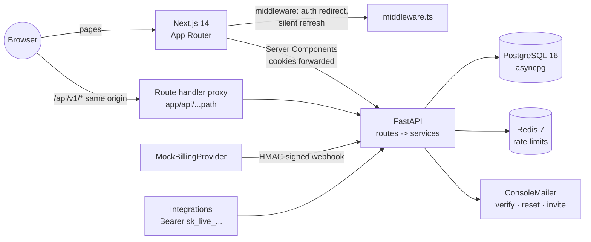

<!-- topics: saas,multi-tenant,fastapi,nextjs,typescript,postgresql,redis,jwt,rbac,billing,starter-kit,tailwindcss -->
# SaaS Starter Kit

A multi-tenant SaaS starter: a FastAPI backend (async SQLAlchemy, Alembic, Postgres, Redis) and a Next.js 14 App Router frontend, with organizations, roles, team invites, API keys, plan limits, mock billing with signed webhooks, an audit log and an admin area already wired together.

[](https://github.com/AkibUllah/saas-starter-kit/actions/workflows/ci.yml)


## Why this exists

Every B2B product I have built, from merchant dashboards for payment gateways to retail back-offices, needed the same foundation before the first real feature: tenants, roles, invites, API keys for integrators, a plan table that the API actually enforces, a billing webhook that is idempotent, and an audit trail that support can read. Getting the security details right (rotating refresh tokens, cookies the browser can't read from JavaScript, cross-tenant ids that look like 404s) takes longer than the features themselves. This repo is that foundation, written once, tested, and runnable with one compose command.

## Features

- **Auth**: signup/login with bcrypt, 15-minute JWT access tokens and 30-day rotating refresh tokens in httpOnly cookies (also returned in the body for API clients), refresh-token reuse detection that revokes the whole token family, email verification and password reset via single-use hashed tokens (console mail backend), lockout after 5 failed logins, per-IP rate limits (Redis or in-memory)
- **Tenancy**: organizations with `owner` / `admin` / `member` roles, org switcher, every query scoped by `org_id`, last-owner protection, invite by email with expiring tokens, re-invite revokes the old link, email-mismatch checks
- **API keys**: per-org `sk_live_<prefix>_<secret>` keys, only a SHA-256 hash stored, scopes (`org:read`, `projects:read`, `projects:write`), expiry, revocation, `last_used_at`
- **Plans and entitlements**: Free / Pro / Business with limits on projects, members and API keys and feature flags (audit log, SSO); enforced server-side with HTTP 402 and a stable `plan_limit_reached` code, mirrored by the pricing page and usage meters
- **Billing**: subscription per org, mock checkout session, a `MockBillingProvider` that emits HMAC-signed webhooks through the same handler a real provider would hit, event-id idempotency, timestamp tolerance, `invoice.paid` / `invoice.payment_failed` (past_due) / `subscription.canceled`, cancel and resume at period end
- **Audit log**: every security and data change recorded with actor, target, metadata and IP; filterable and paginated; gated to paid plans
- **Admin**: superuser-only stats (users, verified, active in 30 days, orgs, projects, MRR, plan/status breakdown, signups per day), user search and disable, org list
- **Frontend**: marketing landing with pricing, auth pages, onboarding, dashboard shell (sidebar, org switcher, user menu), projects, team, API keys, billing with mock checkout, settings, audit log, admin; middleware for auth redirects and silent refresh; same-origin route-handler proxy; dark mode
- **Ops**: `/health` and `/health/ready`, JSON logs with `X-Request-ID`, OpenAPI at `/api/v1/docs`, Alembic migration checked against the models in CI, dev and prod compose, nginx, Makefile, seed script

## Architecture



Key decisions:

- **Cookies, not localStorage.** Login and refresh set httpOnly, SameSite=Lax cookies. The browser talks only to the Next.js origin; the catch-all route handler forwards cookies and `Set-Cookie` to the API, so there is no CORS in the browser path and tokens never touch JavaScript.
- **Refresh rotation with family revocation.** Each refresh token is stored as a hash with a `family_id`. Using a token rotates it; presenting an already-rotated token is treated as theft and revokes every live token in that family.
- **Tenancy at the dependency layer.** `get_org_context` resolves the org, the caller (user session or API key) and the role once; `require_role` / `require_scope` guard routes, and services look resources up by `(org_id, id)` so an id from another tenant is a 404, not a 403 that confirms it exists.
- **Entitlements in one place.** `Entitlements.require_capacity` and `require_feature` read the same plan table the frontend shows. Limits return 402 with a machine-readable code, which the UI turns into an upgrade prompt.
- **Billing through webhooks only.** Even the mock checkout completes by sending a signed event into `/billing/webhooks/mock`. Plan changes therefore always go through signature checks, idempotency on the provider event id and the audit log, and swapping in Stripe or SSLCommerz means replacing the provider class, not the state machine.
- **Time is injected.** Services read `ctx.clock`; model timestamps use a swappable clock and a UTC-normalising column type, so tests jump 31 days to expire refresh tokens without sleeping and SQLite behaves like Postgres.

## Tech Stack

| Layer | Choice |
| --- | --- |
| API | FastAPI, Pydantic v2, pydantic-settings, SQLAlchemy 2.0 async, Alembic, PyJWT, bcrypt |
| Data | PostgreSQL 16 (asyncpg), Redis 7; SQLite (aiosqlite) for tests and quick local runs |
| Frontend | Next.js 14.2 App Router, React 18.3, TypeScript 5.4 strict, Tailwind 3.4, TanStack Query 5, zod, lucide-react |
| Quality | pytest + pytest-asyncio + httpx, ruff, vitest + Testing Library, ESLint (next/core-web-vitals) |
| Delivery | Docker (python:3.11-slim, node:18-alpine standalone, non-root), compose for dev and prod, nginx, GitHub Actions |

## Quick Start

### Docker compose

```bash
git clone git@github.com:AkibUllah/saas-starter-kit.git
cd saas-starter-kit
cp .env.example .env
docker compose up --build
# app: http://localhost:3000   ·   API docs: http://localhost:8000/api/v1/docs
```

The backend container runs `alembic upgrade head` and, in dev compose, seeds demo data (`SEED_DEMO=true`).

### Local without Docker (SQLite)

```bash
make install                                    # backend venv + npm ci
cd backend
export APP_DATABASE_URL=sqlite+aiosqlite:///./saas.db
.venv/bin/alembic upgrade head
.venv/bin/python -m scripts.seed                # prints the demo credentials
.venv/bin/uvicorn app.main:app --reload --port 8000
# second terminal
cd frontend && BACKEND_URL=http://localhost:8000 npm run dev
```

### Demo accounts (created by the seed script)

| Email | Password | What you see |
| --- | --- | --- |
| `demo@saaskit.dev` | `Demo1234!` | Owner of **Acme Dhaka** (Pro: 5 projects, 3 members, a pending invite, an API key) and **Bogura Agro Supplies** (Free) |
| `fatema@saaskit.dev` | `Demo1234!` | Admin of Acme Dhaka |
| `rahim@saaskit.dev` | `Demo1234!` | Member of Acme Dhaka |
| `admin@saaskit.dev` | `Admin1234!` | Platform superuser: `/admin` |

Verification, reset and invite links are printed in the backend log (console mail backend). On the billing page, upgrades go to a sandbox checkout page; "Pay" emits the signed webhook.

## API

All routes are under `/api/v1` (OpenAPI at `/api/v1/docs`). Auth is the `access_token` cookie or `Authorization: Bearer <jwt | sk_live_...>`.

| Method | Path | Who |
| --- | --- | --- |
| POST | `/auth/signup`, `/auth/login`, `/auth/refresh`, `/auth/logout`, `/auth/logout-all` | public / session |
| POST | `/auth/verify-email`, `/auth/resend-verification`, `/auth/forgot-password`, `/auth/reset-password`, `/auth/change-password` | public / session |
| GET, PATCH | `/users/me` | user |
| GET, POST | `/orgs` | user |
| GET, PATCH, DELETE | `/orgs/{org_id}` | member / admin / owner |
| GET, PATCH, DELETE | `/orgs/{org_id}/members[/{user_id}]` | member (list, leave) / admin |
| GET, POST, DELETE | `/orgs/{org_id}/invites[/{id}]` | admin |
| GET, POST | `/invites/preview?token=`, `/invites/accept` | public / user |
| GET, POST, DELETE | `/orgs/{org_id}/api-keys[/{id}]` | admin |
| GET, POST, PATCH, DELETE | `/orgs/{org_id}/projects[/{id}]` | member, or API key with `projects:read` / `projects:write` |
| GET | `/plans` | public |
| GET | `/orgs/{org_id}/billing` | member |
| POST | `/orgs/{org_id}/billing/checkout`, `.../checkout/{id}/complete`, `/cancel`, `/resume` | owner |
| POST | `/billing/webhooks/mock` | provider (HMAC `X-Mock-Signature` over `timestamp.body`) |
| GET | `/orgs/{org_id}/audit?action=&page=` | admin, Pro+ |
| GET, PATCH | `/admin/stats`, `/admin/users[/{id}]`, `/admin/orgs` | superuser |
| GET | `/health`, `/health/ready` | public |

Errors are `{"detail": "...", "code": "..."}` with stable codes such as `token_expired`, `refresh_reused`, `account_locked`, `plan_limit_reached`, `feature_not_in_plan`, `last_owner`, `missing_scope`; validation errors add `errors: [{field, message}]`.

```bash
# use the seeded API key from a script
curl -H "Authorization: Bearer sk_live_..." http://localhost:8000/api/v1/orgs/<org_id>/projects
```

## Project Structure

```
saas-starter-kit/
├── backend/
│   ├── app/
│   │   ├── api/            # deps (principal, org context, roles, rate limit), cookies, routes/*
│   │   ├── core/           # config, security, plans, clock, logging, rate_limit, mail
│   │   ├── db/             # Base, session factory, UtcDateTime
│   │   ├── models/         # user, org/membership/invite, tokens, api_key, billing, project, audit
│   │   ├── schemas/        # Pydantic request/response models
│   │   ├── services/       # auth, org, invite, api_key, project, billing, entitlements, audit, admin
│   │   └── main.py         # app factory, error handlers, middleware
│   ├── alembic/            # async env + 0001 initial schema
│   ├── scripts/seed.py     # demo org and users
│   └── tests/              # pytest on in-memory SQLite
├── frontend/
│   ├── app/                # (marketing), (auth), onboarding, (dashboard)/dashboard/*, admin, api/[...path]
│   ├── components/         # ui/*, dashboard/*, marketing/PricingTable
│   ├── lib/                # api client, server helpers, validation (zod), plans, utils
│   ├── middleware.ts       # auth redirects + silent refresh
│   └── __tests__/          # vitest
├── nginx/nginx.conf
├── docker-compose.yml · docker-compose.prod.yml · Makefile · .github/workflows/ci.yml
```

## Testing

```bash
make test-backend    # 43 pytest tests
make test-frontend   # 21 vitest tests
make lint            # ruff, ruff format --check, next lint, tsc --noEmit
make build           # next build
```

Backend tests run the real app over httpx against in-memory SQLite with a manual clock and an in-memory mailer. They cover signup/login, lockout and its expiry, rate limiting, access-token expiry, refresh rotation and reuse detection, cookie refresh, logout, email verification, password reset revoking sessions, tenant isolation (cross-org ids return 404/403), role rules (owner-only grants, last-owner protection, leaving), invites (preview, accept, mismatch, revoke, expiry, member limit), API keys (scopes, wrong org, expiry, revocation, plan limit), project CRUD and limits, plan-gated audit log, checkout through the webhook, signature, staleness and idempotency, dunning states, cancel/resume, owner-only billing and the admin stats. CI also runs `alembic upgrade head`, `alembic check` and the seed script.

Frontend tests cover the API client (single refresh-and-retry on expired tokens, error mapping), zod schemas, plan helpers, formatting utils, org selection and UI components (pricing table, buttons, inputs, usage meters).

## Roadmap

- Real provider adapters (Stripe, SSLCommerz) behind the existing `MockBillingProvider` interface, plus seat-based pricing
- SMTP / SES mailer and HTML email templates
- SSO (OIDC) for the Business plan, which the entitlements table already exposes as a feature flag
- Background worker for webhook retries and scheduled period-end cancellations
- Playwright end-to-end tests for signup, invite and upgrade

## License

MIT, see [LICENSE](LICENSE).
